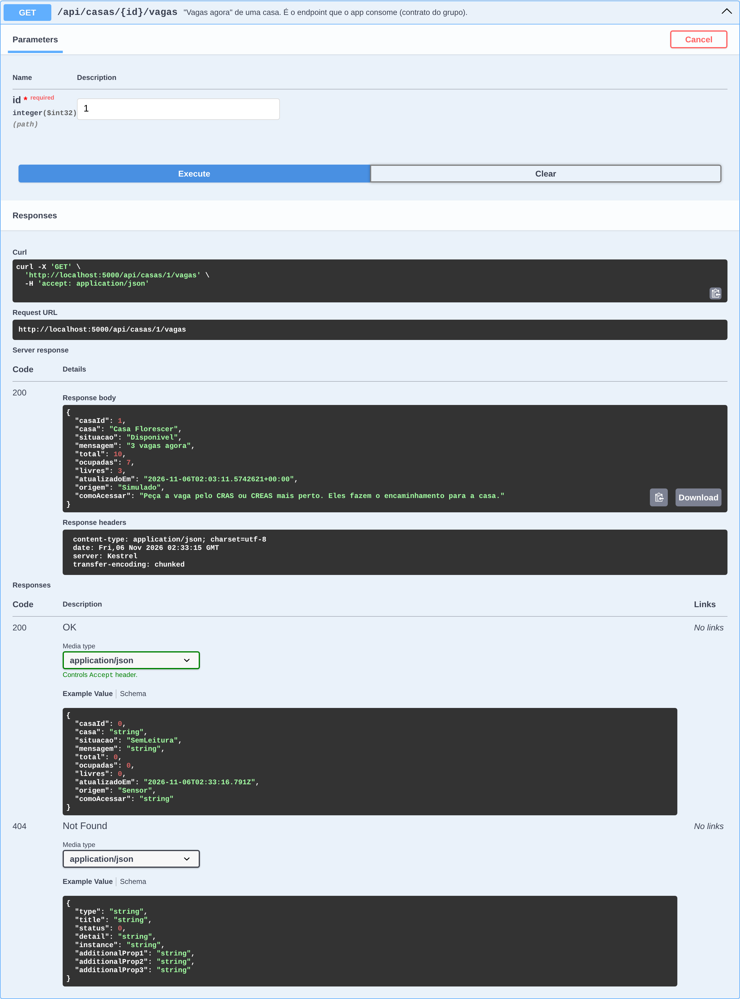
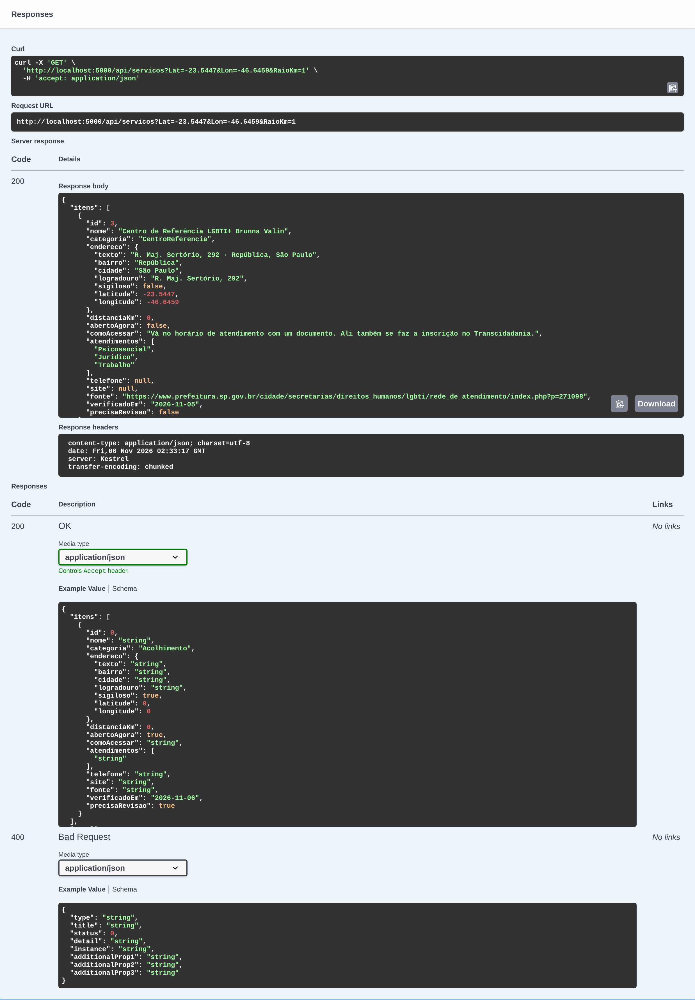

# Aquenda — API C# (.NET 8)

API do **Aquenda**, a CitizenTech do grupo na Global Solution FIAP 2026.2 (Engenharia de Software, 3º ano).
Esta é a entrega de **C# Software Development**: o catálogo de serviços, as vagas das casas de acolhimento (lidas do ESP32 via MQTT), as rodas de conversa e o indicador de impacto anônimo.

## Ficha da CitizenTech

| Campo | Conteúdo |
|---|---|
| Nome | Aquenda |
| Cidade e bairro | São Paulo, com foco no Centro (República, Arouche) e nas regiões dos Centros de Referência LGBTI+ |
| Cidadão beneficiado | Pessoa LGBTQIAPN+ em São Paulo, principalmente trans, travesti ou em vulnerabilidade social |
| Problema, em uma frase | Os serviços de acolhimento, saúde, defesa e trabalho existem, mas estão espalhados, e quem precisa não sabe onde fica o mais próximo nem se será bem atendide |
| Como funciona | App que mostra serviços perto da pessoa (acolhimento, saúde trans, jurídico), vagas afirmativas, salas de conversa moderadas e rolês LGBT+, com agenda de hormônio guardada só no celular |
| O que cada parte faz | App Expo (porta de entrada) · **API C# (catálogo, rodas, vagas das casas)** · FastAPI (vagas de emprego e sync CNES) · ESP32 (ocupação das casas) · ML (desertos de cuidado) · VM Linux (hospedagem) · módulo PII (segurança) |
| Link do repositório | https://github.com/Lynnbrosa/GS-c--AQUENDA |
| Indicador de impacto | Buscas que terminam em "como chegar" ou "ligar" e tempo até achar um serviço, medidos sem guardar quem buscou |
| ODS conectados | 10 Redução das desigualdades · 3 Saúde e bem-estar · 11 Cidades e comunidades sustentáveis |

**Integrantes:**

| Nome | RM |
|---|---|
| Giovanne Charelli Zaniboni Silva | 556223 |
| Gustavo Oliveira de Moura | 555827 |
| Lynn Bueno Rosa | 551102 |

O nome vem do pajubá, a linguagem criada e mantida pela comunidade travesti: *aquenda* é prestar atenção, olhar por alguém.

## O que a API faz

- **Catálogo** (`/api/servicos`): Centros de Referência LGBTI+, casas de acolhimento, saúde trans no SUS, jurídico e rolês. A busca filtra por categoria, atendimento, texto, bairro, raio e "aberto agora", e ordena do mais perto para o mais longe. Cada item diz **como entrar** no serviço ("vá à sua UBS e peça encaminhamento") e traz a fonte pública e a data de verificação.
- **Vagas agora** (`/api/casas/{id}/vagas`): o ESP32 da casa publica a ocupação no MQTT e a API grava. O app mostra "3 vagas agora", "Lotada" ou "Sem informação recente".
- **Rodas de conversa** (`/api/rodas`): agenda de encontros presenciais e grupos já moderados por ONGs. Não tem chat: é a v1 decidida no pitch.
- **Indicador de impacto** (`/api/metricas`): conta por dia quantas buscas terminam em "como chegar" ou "ligar". Não existe coluna para usuário, IP ou aparelho.
- **Avisar que fechou** (`POST /api/servicos/{id}/avisos-fechamento`): depois de 3 avisos o item volta para a curadoria.

## Como rodar

Pré-requisito: [.NET 8 SDK](https://dotnet.microsoft.com/download/dotnet/8.0).

```bash
dotnet run --project src/Aquenda.Api
```

Abre em http://localhost:5000/swagger. Na primeira subida a API aplica as migrações e semeia o catálogo sozinha.

Testes:

```bash
dotnet test
```

Para gravar vagas pela API (rotas com cadeado no Swagger), configure uma chave e mande no cabeçalho `X-Chave-Operador`:

```bash
Seguranca__ChaveOperador=minha-chave dotnet run --project src/Aquenda.Api
```

```bash
curl -X POST http://localhost:5000/api/casas/1/vagas -H "X-Chave-Operador: minha-chave" -H "Content-Type: application/json" -d '{"total":10,"ocupadas":7}'
```

Em `Development` a escrita fica liberada sem chave. Fora dele, sem chave configurada a escrita responde 503.

### Publicar na VM (contrato do grupo)

```bash
dotnet publish src/Aquenda.Api -c Release -o /opt/aquenda/api
```

| Variável | Valor na VM |
|---|---|
| Porta | 5000 (já é o padrão em `appsettings.json`) |
| `ConnectionStrings__Default` | `Data Source=/var/lib/aquenda/aquenda.db` (a pasta é criada se não existir) |
| `Seguranca__ChaveOperador` | segredo da equipe, fora do repositório |
| `Mqtt__Habilitado` | `true` (padrão) |

Saúde do serviço para o monitoramento: `GET /health`. Um exemplo de unidade systemd está em [`docs/deploy/aquenda-api.service`](docs/deploy/aquenda-api.service).

### Contrato com o ESP32 (Physical Computing)

- Broker: `broker.hivemq.com:1883`
- Tópico: `aquenda/casa/{casaId}/vagas` (a API assina `aquenda/casa/+/vagas`)
- Payload: `{"total":10,"ocupadas":7,"ts":"2026-11-14T21:00:00Z"}` (`ts` opcional)

Os ids das casas saem em `GET /api/casas`. No seed, a Casa Florescer é a casa 1. Mensagem com tópico ou JSON fora do contrato, ou com números impossíveis (ocupadas > total), é registrada no log e descartada sem derrubar o serviço. Se o broker cair, a API reconecta com espera crescente até 60 s.

## Endpoints

| Método | Rota | O que faz |
|---|---|---|
| GET | `/api/servicos` | Busca com filtros (`categoria`, `atendimento`, `texto`, `bairro`, `lat`, `lon`, `raioKm`, `abertos`, `pagina`, `tamanho`) |
| GET | `/api/servicos/{id}` | Detalhe com horários e os dados do tipo (saúde, acolhimento, jurídico...) |
| GET | `/api/servicos/resumo` | Quantidade por categoria e itens em revisão |
| POST | `/api/servicos/{id}/avisos-fechamento` | "Avisar que fechou" (anônimo, com limite de 30 por minuto) |
| GET | `/api/casas` | Painel de vagas de todas as casas |
| GET | `/api/casas/{id}/vagas` | Vagas agora de uma casa |
| POST | `/api/casas/{id}/vagas` | Contagem manual, reserva para quando o sensor está fora (exige chave) |
| GET | `/api/casas/{id}/vagas/historico?horas=24` | Histórico com média, pico e quantas vezes lotou |
| GET | `/api/rodas?dias=30&presencial=true` | Próximas rodas |
| GET | `/api/rodas/{id}` | Uma roda |
| POST | `/api/rodas` | Cadastra roda (exige chave) |
| POST | `/api/metricas/interacoes` | Conta um "como chegar", "ligar" ou "abrir site" |
| GET | `/api/metricas/impacto?de=&ate=` | Indicador de impacto do período |
| GET | `/health` | Saúde da API e do banco |

Erros voltam como ProblemDetails (RFC 7807): 400 para parâmetro inválido, 404 para recurso inexistente, 422 para regra de negócio e 401/503 para chave.

## Arquitetura

```
src/
  Aquenda.Domain/          entidades, objetos de valor, regras, interfaces de repositório
  Aquenda.Application/     casos de uso (catálogo, ocupação, rodas, métricas)
  Aquenda.Infrastructure/  EF Core + SQLite, repositórios, migrações, seed, MQTT
  Aquenda.Api/             controllers, DTOs, Swagger, tratamento de erros
tests/
  Aquenda.Tests/           111 testes xUnit (domínio, aplicação com SQLite real, MQTT, API)
```

As dependências apontam para dentro: a API conhece a aplicação, a aplicação conhece o domínio, e o domínio não conhece ninguém. A infraestrutura implementa as interfaces do domínio.

## Onde cada critério da rubrica aparece

| Critério | Peso | Onde ver |
|---|---|---|
| **POO** | 3,0 | `Servico` é abstrata, com 5 filhas (`CasaAcolhimento`, `CentroReferencia`, `UnidadeSaude`, `ServicoJuridico`, `LocalRole`). **Polimorfismo:** cada uma sobrescreve `InstrucaoPadrao()` e `Categoria`. **Encapsulamento:** setters privados e coleções expostas como `IReadOnlyCollection`. Uma `LeituraOcupacao` só nasce por `CasaAcolhimento.RegistrarLeitura`, que valida as regras. **Objetos de valor:** `Coordenada` (Haversine), `Endereco` (sigiloso nunca mostra a rua) e `HorarioFuncionamento` (faixa que passa da meia-noite). Tudo em `src/Aquenda.Domain`. |
| **Interfaces e injeção de dependência** | dentro de POO e Web API | Repositórios (`IServicoRepository`, `ICasaAcolhimentoRepository`...), `IUnitOfWork` e `IRelogio` no domínio e na aplicação; implementações registradas em `AddAquendaInfrastructure` e `AddAquendaApplication`. O `IRelogio` deixa os testes controlarem "agora". |
| **Web API** | 2,5 | 4 controllers REST com status corretos (200, 201 + Location, 202, 204, 400, 401, 404, 422, 429), validação por DataAnnotations, ProblemDetails, CORS, limite de requisições, health check e Swagger com comentários XML. |
| **EF Core + LINQ** | 1,5 | Herança TPH numa tabela só, tipos owned (`Endereco`, `Horarios`), migração em `Dados/Migracoes`, conversor de datas UTC. LINQ no SQL: filtro por flags (`&`), `LIKE` com escape, caixa geográfica, `GroupBy` por discriminador e "última leitura de cada casa" (vira `ROW_NUMBER()`). LINQ em memória: distância exata, ordenação, paginação e as agregações do indicador (`GroupBy`, `Sum`, `Average`, `Max`). |
| **Async/await** | 1,0 | Todo o caminho do banco é assíncrono com `CancellationToken`. O `MqttOcupacaoListener` é um `BackgroundService` com reconexão e backoff, e o banco é migrado e semeado de forma assíncrona na subida. |
| **Qualidade do código** | 2,0 | Camadas separadas, nomes em português do domínio, sem avisos de compilação, 111 testes (unidade, integração com SQLite real e `WebApplicationFactory`) e CI no GitHub Actions. |

## Decisões de segurança e privacidade

- **Endereço sigiloso:** casas de acolhimento guardam só o bairro e a coordenada do bairro. O domínio recusa um endereço sigiloso com rua, e roda aberta não pode ser marcada nele.
- **Métricas sem pessoa:** a tabela `InteracoesDiarias` só tem dia, tipo, categoria, serviço e quantidade.
- **Agenda de hormônio, consultas e PIN não passam por aqui.** Ficam só no celular (contrato do grupo).
- **Escrita protegida:** rotas de operador exigem `X-Chave-Operador`, comparado em tempo constante.
- **Sensor não é confiável por padrão:** leitura com ocupadas > total, total fora de 1–500 ou data no futuro é recusada.
- **Limite:** o broker MQTT público aceita publicação de qualquer um. Para produção, o próximo passo é um broker com usuário e senha ou TLS.

## Dados

O seed vem da pesquisa do grupo (pitch, 05/11/2026). Cada item tem a fonte pública em `Fonte`. As coordenadas são aproximadas (rua ou centro do bairro) e devem ser conferidas com a BrasilAPI. Onde a pesquisa não achou endereço ou horário, o campo fica vazio e a API responde "não sei" (`abertoAgora: null`) em vez de chutar. A leitura de vagas da Casa Florescer e a roda de sábado são **exemplos** (`origem: "Simulado"` e `exemplo: true`).

Fontes: [Centros de Referência LGBTI+](https://www.prefeitura.sp.gov.br/cidade/secretarias/direitos_humanos/lgbti/rede_de_atendimento/index.php?p=271098) · [Rede SAMPA Trans (jan/26)](https://prefeitura.sp.gov.br/documents/d/saude/avancos-e-desafios-_-jan26-pdf) · [SMADS, acolhimento LGBTQIA+](https://prefeitura.sp.gov.br/web/assistencia_social/w/m%C3%AAs-do-orgulho-lgbtqia-existir-resistir-e-recome%C3%A7ar) · [OAB SP, NUDIVERSIS](https://www.oabsp.org.br/upload/548328681.pdf) · [Brasil de Fato, Casa 1](https://www.brasildefato.com.br/?p=568969) · [São Paulo Secreto, guia LGBT+](https://saopaulosecreto.com/guia-balada-bares-lgbt-gay-sp/)

## Evidências

Swagger com todos os endpoints:


Vagas agora da Casa Florescer:



Busca a 1 km do Centro de Referência, do mais perto para o mais longe:


